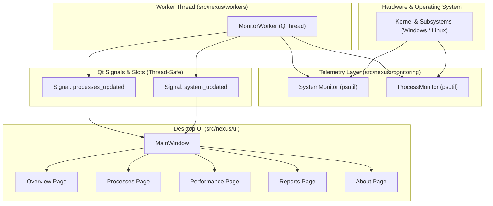

# NEXUS — Smart Resource Monitor & Process Manager

<div align="center">


-41CD52?style=for-the-badge&logo=qt)


**A high-performance, student-built desktop resource monitor and safe process management suite demonstrating Operating System concepts.**

</div>

---

## 1. Project Purpose & Problem Statement

Operating systems execute thousands of concurrent threads and manage gigabytes of physical and virtual memory every second. Standard built-in task managers can be opaque and fail to convey the underlying operating system concepts (such as process control blocks, CPU sampling intervals, virtual memory pages, and kernel privilege rings).

**NEXUS** was built to provide an educational, transparent, and aesthetically polished desktop tool that allows students, developers, and educators to:
1. Observe real, non-fabricated system resource usage in real time.
2. Explore running processes, inspect memory allocation (RSS vs. VMS), and observe thread counts.
3. Understand safe process lifecycle management and operating system protection policies.
4. Export system diagnostic reports to CSV and JSON without any external telemetry or data tracking.

---

## 2. Key Objectives & Features

- **Live Overview Dashboard:**
  - Real-time CPU, RAM, Disk, and System Uptime cards.
  - Interactive, GPU-accelerated time-series charts powered by `pyqtgraph`.
  - Top 5 CPU and Memory consumers tables.
  - Configurable sampling intervals (1s, 2s, 5s) and pause/resume capability.
- **Process Explorer:**
  - Comprehensive process table displaying PID, Name, CPU %, Memory %, RAM (MB), Status, User, and Threads.
  - Dynamic instantaneous search by process name or PID.
  - Multi-column sorting (sort by CPU, memory, PID, or threads with a single click).
  - Detailed modal inspector displaying executable paths, start times, and virtual memory statistics.
- **Safe Process Management:**
  - Conservative protection against terminating kernel PIDs (0, 1), system components (`csrss.exe`, `systemd`, etc.), and the monitor itself.
  - Mandatory confirmation modal before issuing any termination request.
  - Graceful `SIGTERM` request with timeout detection; never automatically forces termination.
- **Performance & Hardware Profile:**
  - System architecture breakdown (CPU cores, logical processors, frequencies).
  - Storage partitions and file system mount point metrics.
  - Real-time network throughput (download and upload rates in KB/s).
- **Reports & Diagnostic Exports:**
  - Export the current accessible process list to standard CSV.
  - Export a system summary snapshot to structured JSON.
- **Design & Usability:**
  - Dark mode by default with an optional Light theme.
  - Alert banner automatically triggered when CPU or RAM exceeds safety thresholds.
  - Completely non-blocking UI powered by asynchronous `QThread` workers.

---

## 3. Technology Stack

- **Language:** Python 3.11+
- **Desktop Framework:** PySide6 (Qt for Python 6)
- **Telemetry & Metrics:** psutil
- **Real-Time Charting Engine:** pyqtgraph
- **Test Automation:** pytest
- **Persistence & Serialization:** csv, json (standard library)

---

## 4. System Architecture



---

## 5. Installation & Setup

### Prerequisites
- Python 3.11 or newer (Python 3.11, 3.12, 3.13 supported)
- Windows 10/11 or modern Linux distribution

### Windows Setup

1. **Clone the repository:**
   ```bash
   git clone https://github.com/your-username/nexus-resource-monitor.git
   cd "nexus-resource-monitor"
   ```

2. **Create and activate a virtual environment:**
   ```powershell
   python -m venv .venv
   .\.venv\Scripts\Activate.ps1
   ```

3. **Install dependencies:**
   ```powershell
   python -m pip install --upgrade pip
   pip install -r requirements.txt
   ```

### Linux Setup

```bash
python3 -m venv .venv
source .venv/bin/activate
pip install -r requirements.txt
```

---

## 6. Launching the Application

Run the application directly via the root entry point:

```bash
python main.py
```

Or install in editable mode and run the registered command:

```bash
pip install -e .
nexus
```

---

## 7. Running Automated Tests

Run the full pytest test suite:

```bash
python -m pytest -v
```

All unit tests run without requiring a physical display or elevated administrative privileges.

---

## 8. Operating System Concepts Demonstrated

1. **Process Control Block (PCB):** Maps PID, thread counts, and memory boundaries directly from the OS kernel.
2. **CPU Rate Calculations:** Demonstrates why initial per-process readings require a baseline reading before deltas can be calculated.
3. **Virtual Memory & RSS:** Explains how memory management systems separate physical resident memory from virtual address space.
4. **Privilege Rings & Access Control:** Illustrates why user-space applications cannot terminate kernel services or other users' processes without elevated tokens.
5. **Multi-threaded Asynchronous Concurrency:** Demonstrates decoupling heavy OS polling from UI event loops via Qt signals and slots.

For in-depth explanations, read [`docs/OS_CONCEPTS.md`](docs/OS_CONCEPTS.md).

---

## 9. Known Limitations

- **Platform Dependencies:** Windows CPU frequency is dynamic and may report differently than Linux clock governors.
- **Inaccessible Processes:** System processes protected by OS access controls (e.g., anti-cheat drivers or secure kernel processes) do not expose their full executable path or command-line strings to unprivileged users.
- **GPU Metrics:** To maintain cross-platform stability without bulky vendor drivers (such as CUDA or NVML), GPU metrics are omitted in favor of universal CPU and RAM monitoring.

---

## 10. Folder Structure

```
nexus-resource-monitor/
├── .env.example
├── .gitattributes
├── .gitignore
├── LICENSE
├── pyproject.toml
├── README.md
├── requirements.txt
├── main.py
├── src/
│   └── nexus/
│       ├── __init__.py
│       ├── app.py
│       ├── config.py
│       ├── monitoring/
│       │   ├── __init__.py
│       │   ├── system_monitor.py
│       │   └── process_monitor.py
│       ├── workers/
│       │   ├── __init__.py
│       │   └── monitor_worker.py
│       ├── ui/
│       │   ├── __init__.py
│       │   ├── components.py
│       │   ├── main_window.py
│       │   ├── styles.py
│       │   └── pages/
│       │       ├── __init__.py
│       │       ├── about.py
│       │       ├── overview.py
│       │       ├── performance.py
│       │       ├── processes.py
│       │       └── reports.py
│       ├── services/
│       │   ├── __init__.py
│       │   └── export_service.py
│       └── utils/
│           ├── __init__.py
│           └── logging_config.py
├── tests/
│   ├── test_export_service.py
│   ├── test_process_monitor.py
│   └── test_system_monitor.py
├── docs/
│   ├── ARCHITECTURE.md
│   ├── OS_CONCEPTS.md
│   ├── PROJECT_OVERVIEW.md
│   └── TESTING.md
└── screenshots/
    └── README.md
```

---

## 11. Viva Questions & Answers

1. **Q: What is the difference between RSS and VMS?**  
   *A:* RSS (Resident Set Size) is the amount of physical RAM allocated to a process. VMS (Virtual Memory Size) is the total virtual address space mapped, including pages stored in the swap file or unallocated space.

2. **Q: Why does the initial CPU percent reading show 0%?**  
   *A:* CPU percentage represents the rate of execution over an elapsed duration. On the first sample, there is no previous timestamp or execution tick baseline, so the delta is zero.

3. **Q: Why does the application use a background thread for monitoring?**  
   *A:* In modern desktop GUIs, the main thread runs the event loop responsible for handling mouse clicks, painting frames, and window resizing at 60 FPS. Iterating over hundreds of operating system processes via kernel system calls causes I/O latency; running it on a background `QThread` ensures the UI remains smooth and responsive.

4. **Q: What is PID 0 and PID 1?**  
   *A:* PID 0 is the System Idle Process (Kernel scheduler), and PID 1 is the first user-space initialization process (such as `systemd` or `init` in Linux, or system startup binaries in Windows). Neither can be terminated without crashing the operating system.

5. **Q: How does NEXUS prevent memory leaks from continuous chart updates?**  
   *A:* Chart series data is stored in bounded ring buffers (`collections.deque(maxlen=60)`). When a new sample arrives, the oldest sample is automatically discarded, maintaining constant memory overhead.

---

## 12. Contributing & License

Contributions are welcome! Please submit a Pull Request or open an Issue for bug reports or feature requests.

Distributed under the **MIT License**. See [`LICENSE`](LICENSE) for more information.
