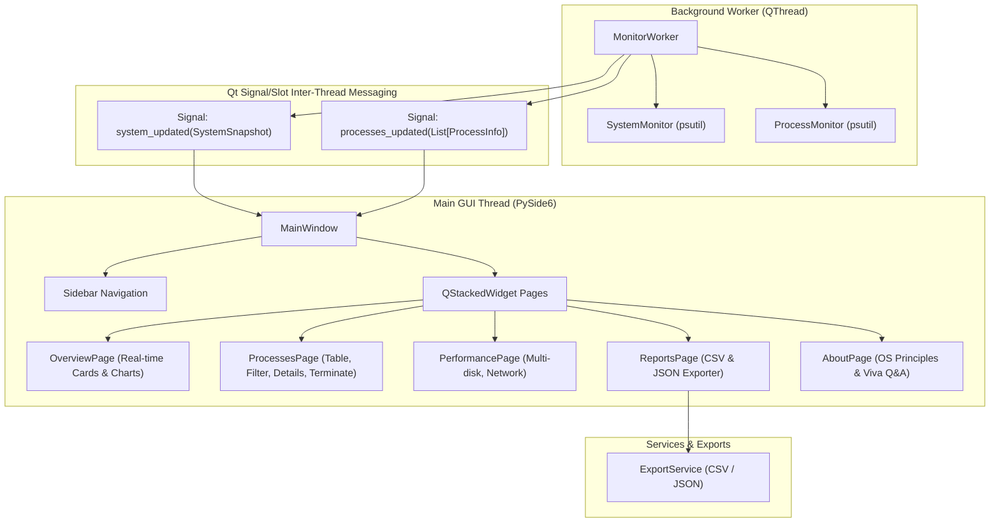

# System Architecture & Technical Design

NEXUS is designed around modularity, separation of concerns, and thread safety.

## Architectural Principles

1. **Separation of Presentation & Telemetry:** 
   The telemetry layer (`src/nexus/monitoring`) has zero Qt dependencies, allowing comprehensive automated testing via `pytest` without a desktop display or mock GUI.
2. **Thread Safety via Signal/Slot:**
   Background worker threads never touch UI widgets directly. All communication is performed using thread-safe Qt Signals with copy-on-write Python dataclasses (`SystemSnapshot`, `ProcessInfo`).
3. **Bounded Memory Profile:**
   Chart series are backed by collections with bounded deques (`collections.deque(maxlen=60)`), preventing memory leaks during indefinite monitoring runs.
4. **Resilient Exception Isolation:**
   Platform-specific hardware queries and restricted kernel processes (e.g. `psutil.AccessDenied`) are caught and logged without propagating crashes to the UI.
